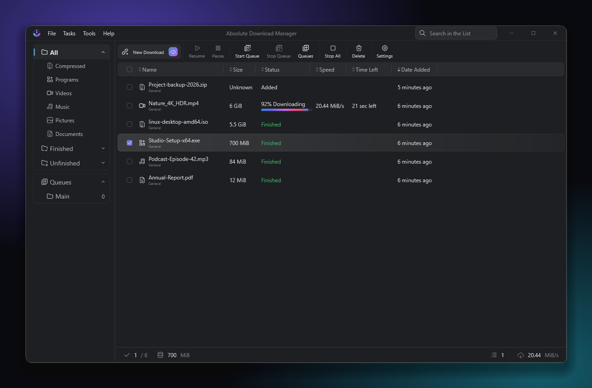
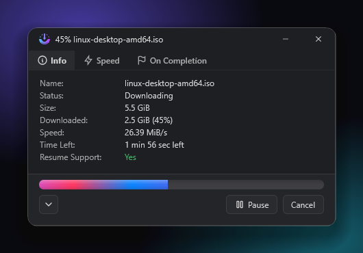
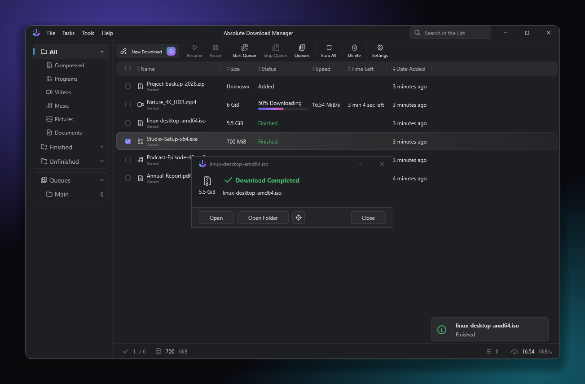

<p align="center">
  
</p>

<p align="center">
  
</p>

<p align="center">
  
  
  
  
</p>

<p align="center">
  <a href="#get-the-app"><b>Get the app</b></a> &nbsp;·&nbsp;
  <a href="#browser-extension"><b>Browser extension</b></a> &nbsp;·&nbsp;
  <a href="#build-from-source"><b>Build from source</b></a>
</p>


## ✦ What it does

<p align="center">
  
</p>

<details>
<summary><b>The details</b></summary>
<br>

- **Segmented, resumable downloads.** One file is downloaded over several connections at once; a part that
  finishes early takes over half of a part that is still running. Downloads survive pauses, restarts and dropped connections.
- **Adapts to the server.** Starts with 8 connections, grows while every one of them is delivering, and backs off
  when a server starts refusing, instead of hammering it.
- **Every network at once (optional).** With *Use all network connections* on, connections are spread over Wi-Fi,
  Ethernet and a USB-tethered phone together, so their speeds add up. Large downloads suggest it when a second network is connected.
- **Queues and scheduler**, speed limiter, proxy support, per-site credentials, and HLS (`.m3u8`) streams.
- **YouTube in every quality.** Point at a playing YouTube video and the extension's "Download video" menu lists
  each quality ("MP4 file, quality 1080p HD 60 fps", "MKV file, quality 1440p HD 60 fps", audio only, or
  *Download all*). The app streams the chosen video and audio over the player's own session, with no extra
  downloader, and merges them with [ffmpeg](https://ffmpeg.org) into one file.
- **Browser extension (Chrome and Edge).** Captures browser downloads with your cookies so logged-in links work,
  detects media on the page, and adds right-click actions.
- **Optional antivirus check.** Scan every finished file with Microsoft Defender.
- **Designed to feel good.** Spring-driven motion throughout (tactile presses, menus that pop from their anchor,
  content that unfolds instead of blinking on), all of it respecting the Windows "Animation effects" setting, and a
  progress bar that keeps gliding between updates. When the window is closed the app idles in the tray at roughly 30 MB.

</details>


## ✦ A look inside

<p align="center">
  
</p>

<table>
  <tr>
    <td width="42%" align="center"><br><sub><b>Live progress.</b> Speed, time left and a bar that glides between ticks.</sub></td>
    <td width="58%" align="center"><br><sub><b>Landing.</b> A completion beat, a notification, and one click to open.</sub></td>
  </tr>
</table>


## Requirements

- Windows 10 or 11 (64-bit).
- To merge video and audio, install ffmpeg once (the rest of the app works without it):

  ```
  winget install Gyan.FFmpeg
  ```

## Get the app

Releases will be listed under **Releases** on this page. To build it yourself, see below.

## Browser extension

1. Start Absolute Download Manager once (this registers it with your browser).
2. Open `chrome://extensions` (or `edge://extensions`) and turn on **Developer mode**.
3. Click **Load unpacked** and choose the `browser-extension` folder from this repository.
4. The extension's ID must be `kdabifjnfldglmdjonpailjebgnefpfe`. The app only trusts that ID.

## Build from source

You need JDK 25 (for example [Temurin 25](https://adoptium.net)). No Android SDK is needed for the desktop app.

```
gradlew :desktop:app:createDistributableAppArchive
```

The app is created in `desktop/app/build/compose/binaries/main-release/app/AbsoluteDownloadManager/`.
Run the tests with `gradlew :desktop:app:test`.

## Project layout

| Folder | Contents |
|---|---|
| `desktop/` | The Windows app (Compose Desktop UI, tray, native-messaging host, YouTube streaming and merge). |
| `downloader/` | The download engine: segmenting, resuming, queues, HLS. |
| `shared/` | Code shared by the app modules: settings, localisation, UI components, motion. |
| `integration/` | The local server and message types the browser extension talks to. |
| `browser-extension/` | The Chrome/Edge extension (Manifest V3). |

## Credits and license

Licensed under the [Apache License 2.0](LICENSE).

Absolute Download Manager is built on [AB Download Manager](https://github.com/amir1376/ab-download-manager)
(Apache-2.0), whose download engine and application framework it extends. See [NOTICE](NOTICE).

Only download content you are permitted to save.
